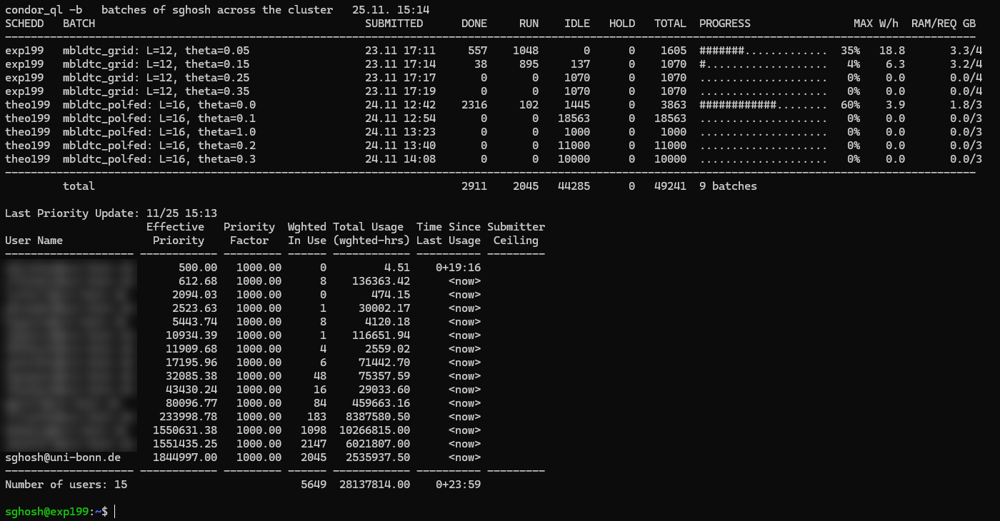

# condor_ql: batch view (-b), condor_userprio (-p) and batch_time_left

The default `condor_ql` does what [README.md](README.md) describes: it takes the `condor_q` (or, with `-hi`, `condor_history`) output in JSON form and prints one clean line per job: host, cluster id, remote host, CPUs, wall time / time left, RAM, disk quota, status and arguments. `-u`, `-s`, `-hn` and `-hi` filter it as before. Nothing in that view has changed.

New flags:
- `-b`: one line per batch (`JobBatchName`) across all schedds, instead of one line per job. The columns are schedd, batch name, submit time, done / running / idle / held / total, a progress bar, the longest running wall time and the peak RAM against the request. DONE is the `TotalSubmitProcs` of the batch's clusters minus the jobs still in the queue. Without `-u` it shows your own jobs.
- `-p`: prints `condor_userprio` below the output (works with every view).

Example output of `condor_ql -b -p`:


## 1. Make plain `condor_ql` mean `condor_ql -b -u $USER`

Run once:

```bash
cat >> ~/.bashrc <<'EOF'
condor_ql() { if [ $# -eq 0 ]; then command condor_ql -b -u "$USER"; else command condor_ql "$@"; fi; }
EOF
source ~/.bashrc
```

With flags it still behaves as before (e.g. `condor_ql -hi`, `condor_ql -s 2`).

## 2. With condor_userprio as well

`-p` adds `condor_userprio` below. To make that the default too, run this instead of step 1:

```bash
cat >> ~/.bashrc <<'EOF'
condor_ql() { if [ $# -eq 0 ]; then command condor_ql -b -p -u "$USER"; else command condor_ql "$@"; fi; }
EOF
source ~/.bashrc
```

Note: on BAF an ssh login reads `~/.bash_profile` when it exists, and then skips `~/.profile` (which is what normally loads `~/.bashrc`). If the command is gone in a new ssh session, run once:

```bash
echo '[ -f ~/.bashrc ] && . ~/.bashrc' >> ~/.bash_profile
```

## batch_time_left

`batch_time_left [pattern]` (asks for the pattern when not given; any part of the batch name, case insensitive) prints, per matching batch of yours in the queue (all schedds), done / running / idle / held and when the last job should be done:
- some jobs already finished: the time per job is the mean wall time of the finished jobs (`condor_history` of the batch's schedd and clusters);
- none finished yet: the time per job is the requested `MaxRuntimeHours` ("raw", an upper bound).

Running jobs need that time minus what they already ran; idle jobs start as the currently running slots free up. Held jobs are not counted. Install it like `condor_ql` (same folder, `chmod +x batch_time_left`).
